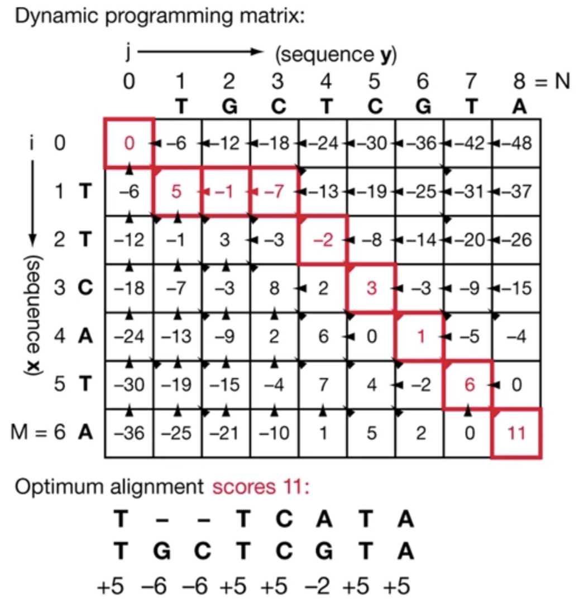
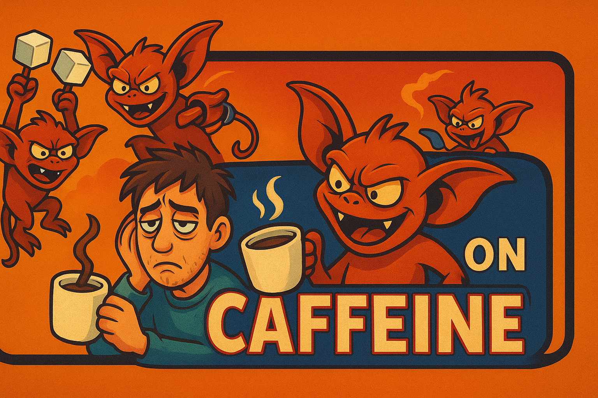

<!-- 
[Register](https://example.com/register){.btn .btn-outline-primary}
 -->

 
Dynamic programming (DP) is a widely used idea in computer science: you break a hard problem into smaller overlapping subproblems and build the answer from their solutions.
The same idea aligns DNA (or string) sequences, finds shortest routes through networks, decodes hidden structure in biological data, and is used in reinforcement learning.

This workshop (designed for five days) shows how Bellman's principle of optimality ties all of these together.
We start with the foundations: memoization, tabulation, complexity analysis, the knapsack problem, and shortest-path alogrithms such as Dijkstra and Bellman-Ford.
We then turn to applications in bioinformatics (one of the biggest areas using DP): global and local sequence alignment, and hidden Markov models with the Viterbi and forward-backward algorithms.
In the second half, we add uncertainty, advancing to stochastic dynamic programming and Markov decision processes.
The workshop ends with reinforcement learning, where the same equations are solved from experience instead of from a known model.

Each day has two lectures (roughly 90 minutes) and two hands-on practical sessions that mix pen-and-paper derivations with implementation in Python.
By the end, participants will have built a toolkit of core algorithms from scratch.
They will also understand when DP applies, how to design a DP solution, and how far it scales.

**Prerequisites:** basic Python or general familiarity with programming, some familitiarity with probabiltiy and maths.
 
---

<!-- Use the tabset for different days? -->
<!-- ::: {.panel-tabset} -->
<!-- ================= Day 1 ================= -->
<!-- :::{.date}
Monday [Date]
:::

:::{layout="[[10]]"}

:::{.card .mb-3}
:::{.card-body}
[Session 1 Title](pages/session1.qmd){.card-title .stretched-link}

:::{.text-muted}
Short description
:::
:::
:::
::: -->

<!-- ================= Day 2 ================= -->
<!-- :::{.date}
Tuesday [Date]
:::

:::{layout="[[5,5]]"}

:::{.card .mb-3}
:::{.card-body}
[Session 2 Title](pages/session2.qmd){.card-title .stretched-link}

:::{.text-muted}
Short description
:::
:::
:::

:::{.card .mb-3}
:::{.card-body}
[Embedding PDFs](pages/embedPDF.qmd){.card-title .stretched-link}

:::{.text-muted}
Display and embed PDFs
:::
:::
:::

::: -->

<!-- ================= Day 3 ================= -->
<!-- :::{.date}
Wednesday [Date]
:::

:::{layout="[[6,4]]"}

:::{.card .mb-3}
:::{.card-body}
[Embedding R code](pages/embedR.qmd){.card-title .stretched-link}

:::{.text-muted}
This is about embedding R code
:::
:::
:::

:::{.card .mb-3}
:::{.card-body}
[Embedding Python code](pages/embedPython.qmd){.card-title .stretched-link}

:::{.text-muted}
Same as R but with Python
:::
:::
:::

::: -->

<!--
Can repeat for more days and sessions...
-->

## What is DP?

{fig-alt="What is DP"}

 

Hosted by:

Lars Berling

MAGPIE group, SFU Maths

 

<!-- 
{fig-alt="host logo" width="35%"}
 -->
